# ЛР 1. HA Postgres Cluster

## Цель работы

Развернуть и настроить высокодоступный кластер Postgres

## Часть 1. Поднимаем Postgres

### Шаги 1-3. Создание файлов

Созданы файлы `Dockerfile1`, `docker-compose.yml`, `postgres0.yml` и `posgres1.yml` (содержимое из методички). Запуск из папки с файлами:

```powershell
docker compose up -d
docker ps
```

#### Вопрос:
 Порты `8008` и `5432` вынесены в разные директивы, `expose` и `ports`. По сути, если записать `8008` в `ports`, то он тоже станет `exposed`. В
чем разница?

#### Ответ: 
Директивы `expose` и `ports` имеют разное назначение.

Директива `expose` указывает порты, используемые для взаимодействия между контейнерами в одной Docker-сети, и не публикует их непосредственно на хостовой машине. В данной конфигурации порт `8008` используется для REST API Patroni, через который HAProxy может проверять состояние узлов кластера и определять текущий основной узел.

Директива `ports` выполняет публикацию портов контейнера на хостовой машине. Запись `5433:5432` означает, что порт `5432`, на котором PostgreSQL принимает подключения внутри контейнера, доступен на хостовой машине через порт `5433`. Аналогично для второго узла используется соответствие `5434:5432`.

Таким образом, `expose` применяется для обозначения портов внутреннего взаимодействия, а `ports` — для предоставления доступа к сервисам через порты хостовой машины. При необходимости порт `8008` также можно опубликовать с помощью `ports`, однако для внутренней проверки состояния узлов со стороны HAProxy это не требуется.

### Шаг 4. Запуск контейнеров
Все 3 контейнера запущены.

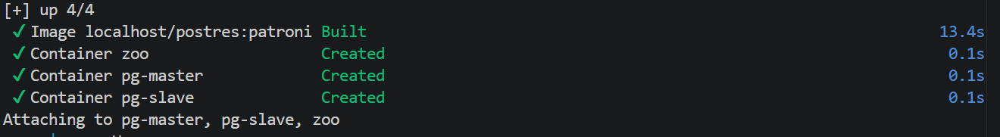

Как мы видим из логов, мастером стала та нода, которая первая сбилдилась, а именно `pg-slave`. Получилось, что мастер -- это `pg-slave`, а слейв -- `pg-master` 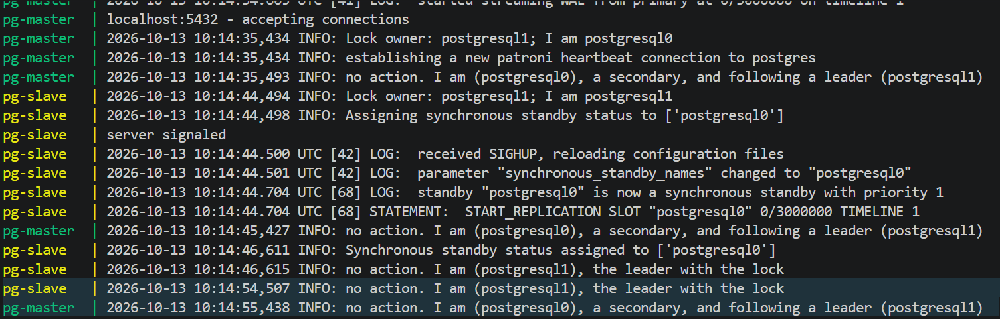.

Чтобы это исправить, мы остановили контейнеры и заново пересобрали в следующем порядке:
1) сначала `pg-master` и `zoo`
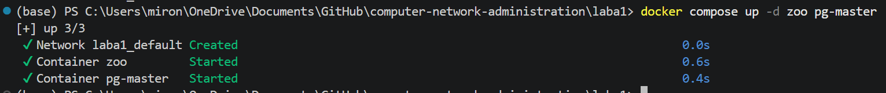

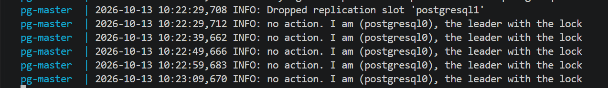

2) потом `pg-slave`

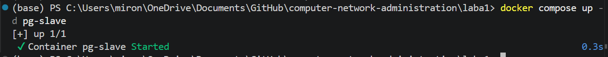


#### Вопрос:
При обычном перезапуске композ-проекта, будет ли сбилден заново образ? А если предварительно отредактировать файлы
postgresX.yml? А если содержимое самого Dockerfile? Почему?

#### Ответ:
При обычном перезапуске копроз-проекта образ не будет заново пересобираться, т.к. докер копоз проверяет, существует ли в системе локальный образ с тегом `localhost/postres:patroni`. Если образ уже есть, докер сразу запускает контейнеры.

Если отредактировать файлы `postgresX.yml` тоже ничего не изменится, т.к. эти файлы находятся на хосте и при перезапуске копроз-проекта докер не заглядывает внутрь папки и не проверяет, изменились ли там файлы, если сам образ уже создан.

Если изменить содержимое самого Dockerfile:
1) при обычной команде `docker compose up`- нет, т.к. стандартный запуск `docker compose up` сначала ищет готовый образ по имени `localhost/postres:patroni`. Если он его находит, он игнорирует изменения в `Dockerfile`. Докер композ не отслеживает изменения в файле сборки автоматически при простом старте.

2) При команде `docker compose up --build` - да, т.к. докер начнет читать `Dockerfile` по строчкам и все строчки до изменения возмет из кэша, а измененная строчка будет выполнена заново.  


## Часть 2. Проверяем репликацию


### Шаг 1. Подключение к обеим нодам

Через DBeaver мы подключились к обеим нодам:

Подключение к pg-master:

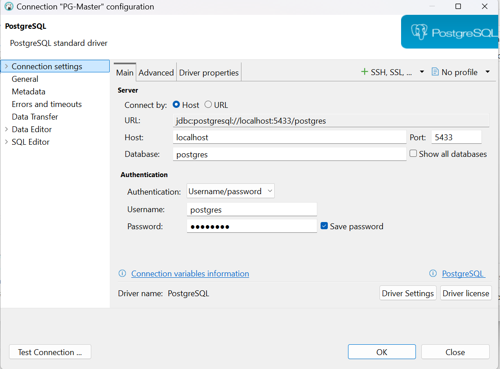

Подключение к pg-slave:

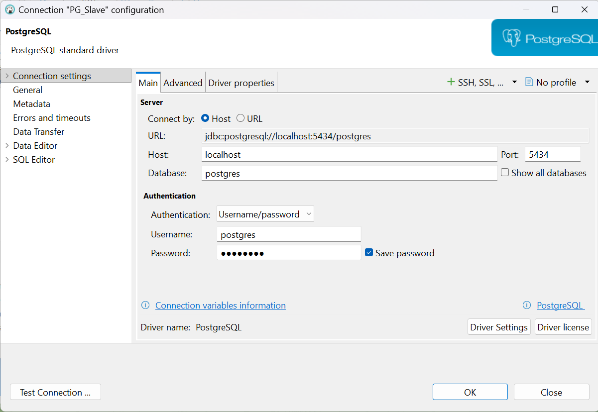


### Шаг 2. Созадние таблицы
Из двух подключений мы выбрали pg-master и создали таблицу:

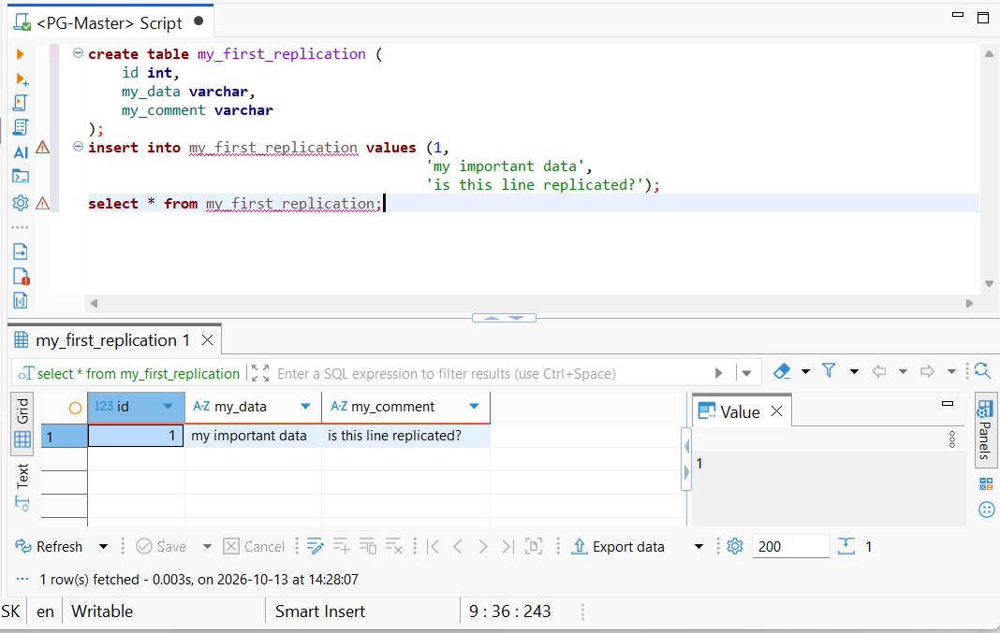


### Шаг 3. Магия репликации
Далее мы зашли в подключение pg-slave и увидели, что во второй базе данных автоматически создалась такая же таблица с такими же данными:

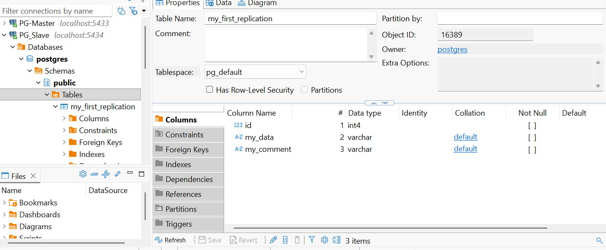

### Шаг 4. Пробуем изменить реплику

В подключении pg-slave мы попытались вставить новые данные в таблицу и олучили отказ, т.к. эта нода работает в режиме slave/readonly

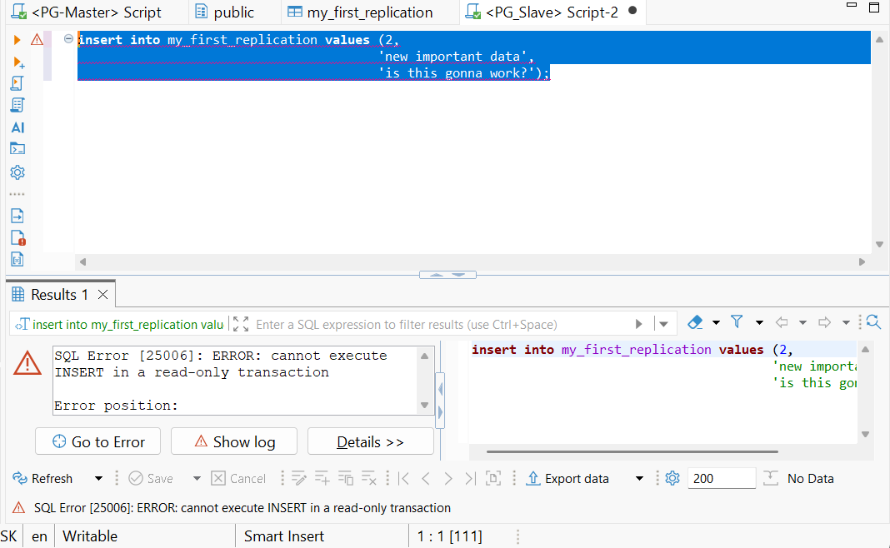

## Часть 3. Делаем высокую доступность

### Шаги 1-2. Балансировщик

В `docker-compose.yml` мы добавили HAProxy и создали `haproxy.cfg` из текста задания

### Шаг 3. Перезапуск

Мы перезапустили проект и видим, что:
1) Обе ноды корректно поднялись и распределили между собой роли мастера и слейва 
2) Зукипер подцепился к кластеру без ошибок
3) Хапрокси поднялась без ошибок


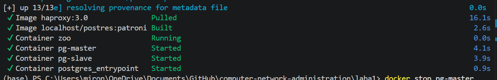

### Шаг 4 Подключение
Мы подключились к “новой” базе данных, в качестве адреса используя имя контейнера с HAProxy и проверили, что подключение успешное - по умолчанию оно всегда будет редиректить трафик на мастер-ноду

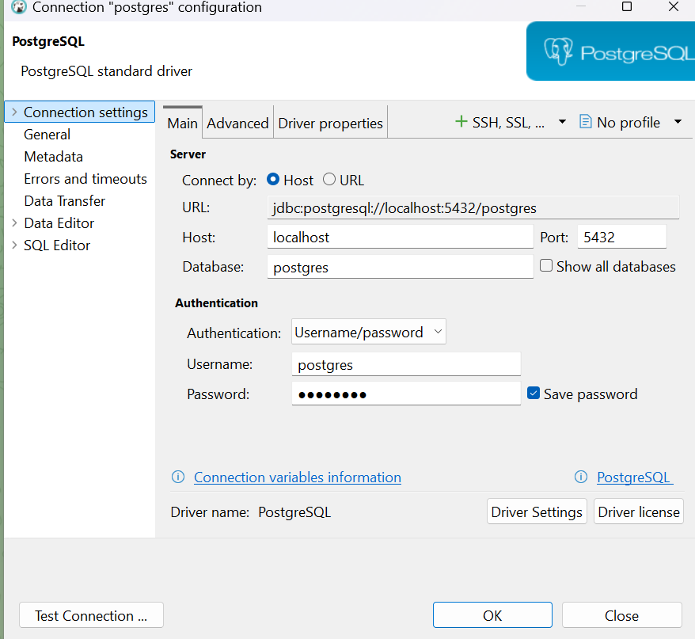


### Часть 4. Принудительная остановка мастера

Для проверки работоспособности нашей системы отключим принудительно мастера:

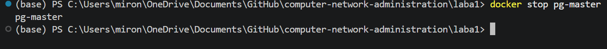

Ждем 10 секунд и анализируем логи:

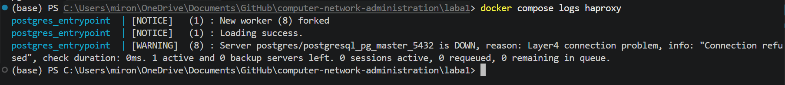

Как мы видим, хапрокси сообщает о том, что мастер УПАЛ

Мы не переживаем, ведь у нас есть реплика базы, которая в таких случаях и должна нас выручать. Попробуем вывести таблицу из реплики:

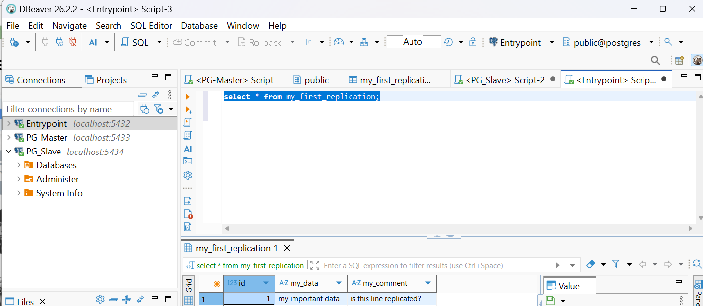

Как мы видим, все данные сохранены, ура-ура

Попробуем что-нибудь записать в базу:

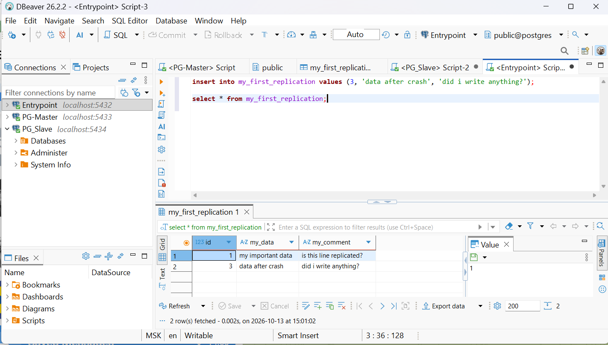

Все записывается, перенаправление на вторую ноду отлично справилось.

Что произошло: после отключения мастер-ноды, балансировщик HAProxy зафиксировал потерю соединения с сервером. При попытке выполнить чтение (SELECT) через единую точку входа (Entrypoint), запрос прошел успешно, так как HAProxy перенаправил трафик на выжившую слейв-ноду. При попытке выполнения записи (INSERT) запись прошла успешно, так как слейв стал новым мастером.

## Вывод

В ходе выполнения лабораторной работы была успешно развернута и протестирована отказоустойчивая архитектура базы данных PostgreSQL с использованием Docker Compose, Zookeeper, Patroni и балансировщика HAProxy.

