# ЛР 2. Loki + Zabbix + Grafana

**Дисциплина:** Администрирование компьютерных сетей
**Автор:** _(ФИО)_
**Группа:** _(номер группы)_

## Цель работы

Подключить к тестовому сервису Nextcloud логирование (Promtail + Loki) и мониторинг (Zabbix), а затем визуализировать данные в Grafana.

## Состав репозитория

| Файл | Назначение |
|---|---|
| `docker-compose.yml` | Описание всех сервисов: Nextcloud, Loki, Promtail, Grafana, Zabbix (server и web) и PostgreSQL для Zabbix |
| `promtail_config.yml` | Конфигурация Promtail: откуда брать логи и куда их отправлять |
| `template.yml` | Шаблон Zabbix для мониторинга Nextcloud |
| `dashboard-nextcloud.json` | Экспорт дашборда Grafana |
| `screenshots/` | Скриншоты хода работы |

## Часть 1. Логирование

### Шаги 1-3. Запуск контейнеров

Созданы файлы `docker-compose.yml` и `promtail_config.yml` (содержимое из методички). Запуск из папки с файлами:

```powershell
docker compose up -d
docker ps
```

Все 7 контейнеров запущены.

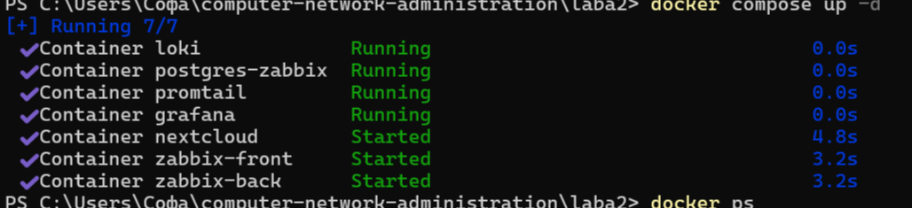

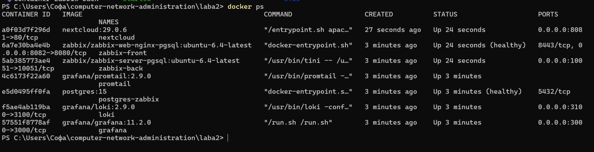

### Шаг 4. Инициализация Nextcloud

Веб-интерфейс Nextcloud открыт по адресу `http://localhost:8081`, создана учётная запись администратора, установка завершена.

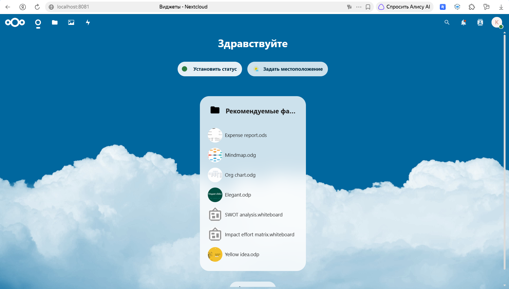

Проверка, что Nextcloud пишет лог в файл `/var/www/html/data/nextcloud.log`:

```powershell
docker exec nextcloud ls -la /var/www/html/data
docker exec nextcloud tail -n 5 /var/www/html/data/nextcloud.log
```

Файл `nextcloud.log` существует, в нём есть записи в формате JSON.

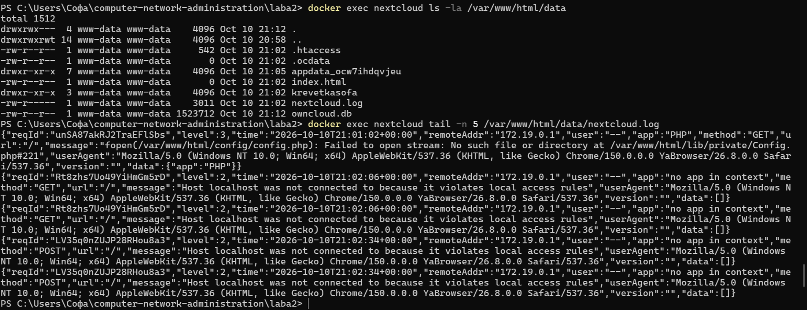

### Шаг 5. Проверка Promtail

```powershell
docker logs promtail 2>&1 | Select-String "Seeked"
```

В логах Promtail есть строка `Seeked /opt/nc_data/nextcloud.log`: Promtail подхватил нужный лог-файл.

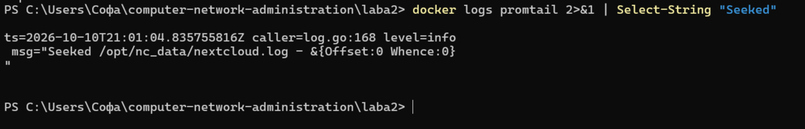

---

## Часть 2. Мониторинг

### Шаги 1-2. Импорт шаблона в Zabbix

Веб-интерфейс Zabbix открыт по адресу `http://localhost:8082` (логин `Admin`, пароль `zabbix`). В разделе **Data collection → Templates** выполнен импорт файла `template.yml`. Шаблон содержит элемент данных `Nextcloud: ping service` (HTTP-запрос к `/status.php`) и триггер `Nextcloud is in maintenance mode`.

Окно предпросмотра импорта:

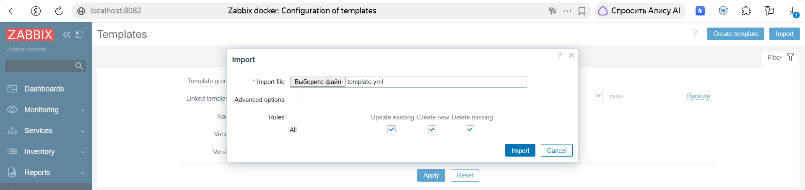

Результат импорта:

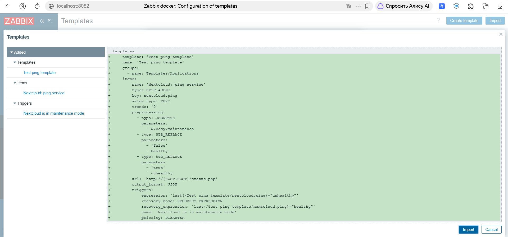

### Шаг 3. Разрешение имени `nextcloud`

Чтобы Zabbix мог обращаться к Nextcloud по имени контейнера, имя добавлено в доверенные домены:

```powershell
docker exec -u www-data nextcloud php occ config:system:set trusted_domains 1 --value="nextcloud"
```

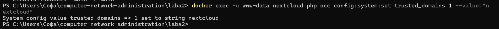

### Шаг 4. Создание хоста

В разделе **Data collection → Hosts** создан хост:

- Host name: `nextcloud` (имя контейнера)
- Visible name: `Nextcloud Server`
- Templates: `Test ping template`
- Host groups: `Applications`

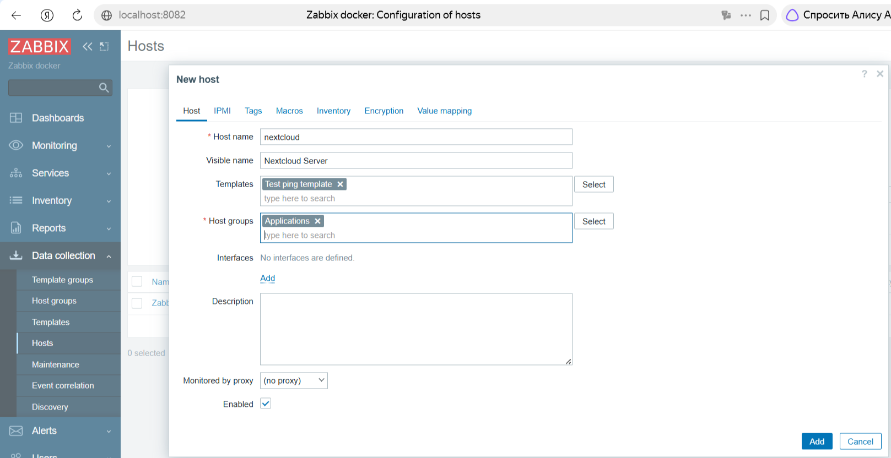

### Шаг 5. Первые данные

В разделе **Monitoring → Latest data** для элемента `Nextcloud: ping service` получено значение `healthy`.

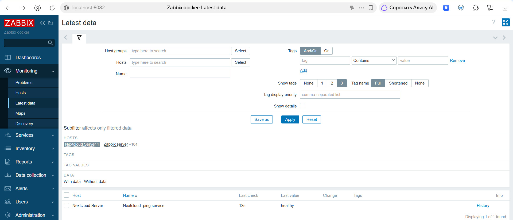

### Шаг 6. Проверка триггера

Включён режим обслуживания Nextcloud, после чего в Zabbix сработал триггер:

```powershell
docker exec -u www-data nextcloud php occ maintenance:mode --on
curl.exe http://localhost:8081/status.php
```

В ответе `status.php` значение `"maintenance":true`.

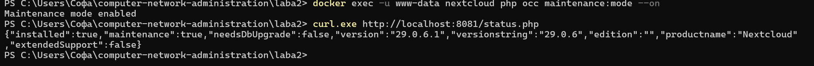

В **Monitoring → Problems** появилась проблема `Nextcloud is in maintenance mode` с важностью Disaster:

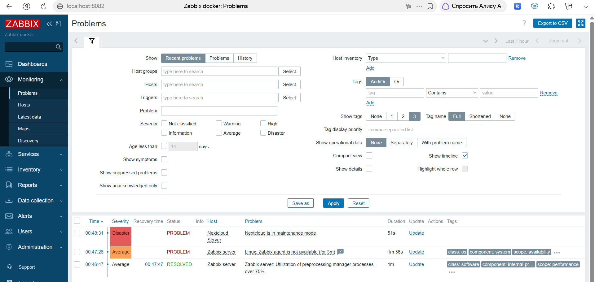

После выключения режима (`php occ maintenance:mode --off`) проблема получила статус **RESOLVED**:

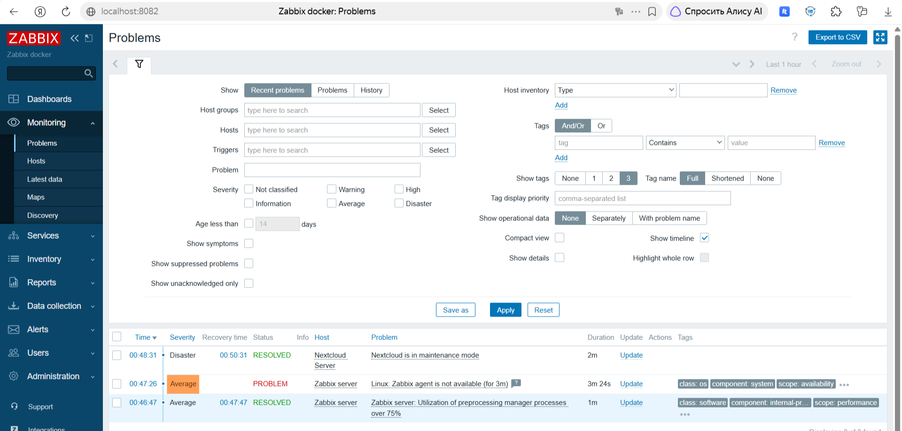

---

## Часть 3. Визуализация

### Шаги 1-2. Плагин Zabbix для Grafana

Плагин установлен командой:

```powershell
docker exec -it grafana bash -c "grafana cli plugins install alexanderzobnin-zabbix-app 4.5.4"
docker restart grafana
```

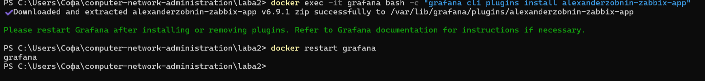

В Grafana (`http://localhost:3000`) в разделе **Administration → Plugins** плагин Zabbix включён

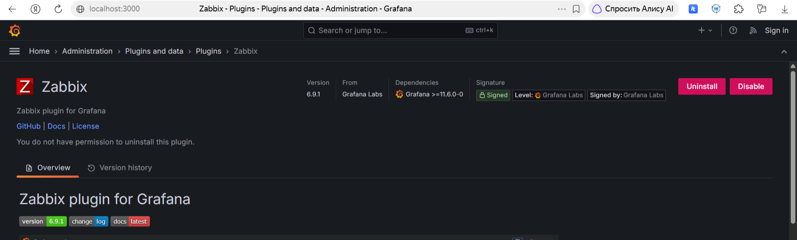

### Шаги 3-4. Источник данных Loki

В **Connections → Data sources** добавлен источник `my_loki_datasource`, URL: `http://loki:3100`. Проверка **Save & test** прошла успешно.

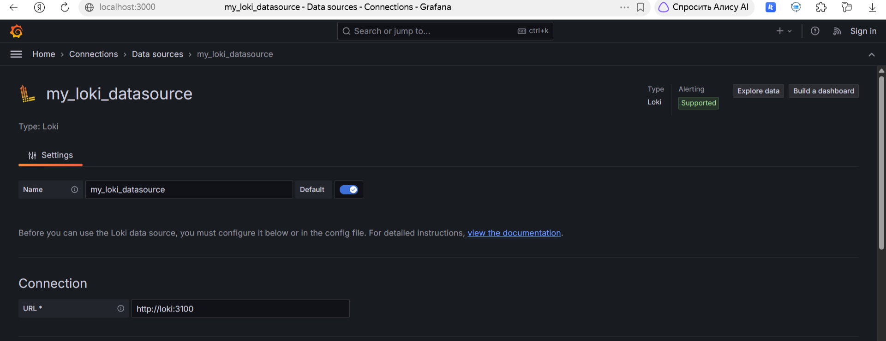

### Шаг 5. Источник данных Zabbix

Добавлен источник `my_zabbix_datasource`, URL: `http://zabbix-front:8080/api_jsonrpc.php`, авторизация по логину и паролю (`Admin`). Проверка прошла успешно, получена версия Zabbix API 6.4.21.

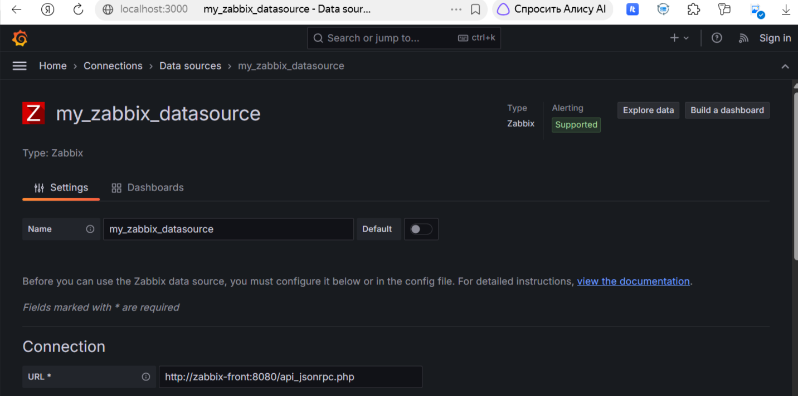

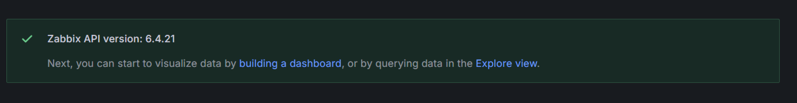

### Шаг 6. Explore: Loki

В **Explore** выбран источник `my_loki_datasource`, фильтр `job = nextcloud_logs`, запрос `{job="nextcloud_logs"}`. Отображаются логи Nextcloud и график количества записей.

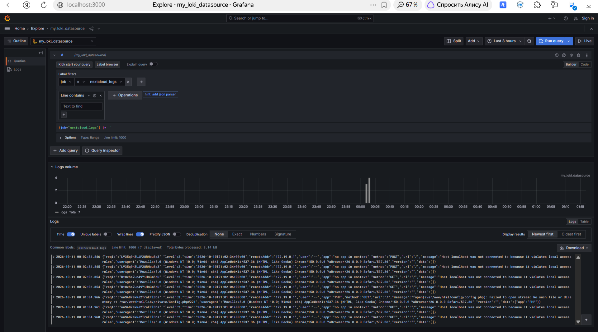

### Шаг 7. Explore: Zabbix

В **Explore** выбран источник `my_zabbix_datasource`. Параметры запроса: Query type `Text`, Group `Applications`, Host `Nextcloud Server`, Item `Nextcloud: ping service`. В таблице видна история значений: `healthy`, затем `unhealthy` (на время включённого режима обслуживания) и снова `healthy`.

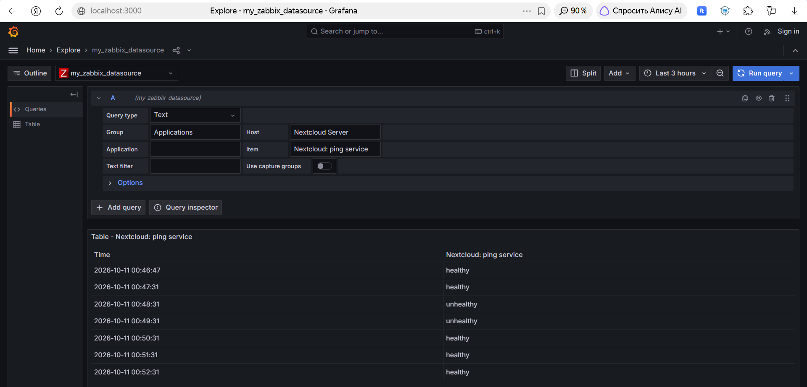

---

## Задание: дашборд в Grafana

Создан дашборд `Nextcloud Logs` из двух панелей.

**Панель `Nextcloud status`** (источник Zabbix, тип визуализации Stat). Настройки: Calculation `Last *`, Color mode `Background solid`, маппинг значений `healthy` → `Nextcloud is: HEALTHY` (зелёный) и `unhealthy` → `Nextcloud is: UNHEALTHY` (красный).

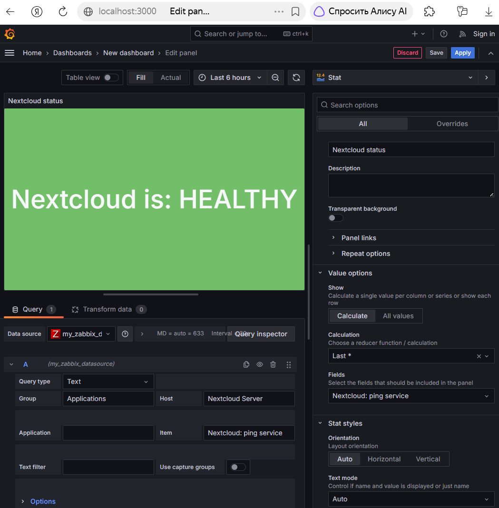

**Панель `Nextcloud Logs`** (источник Loki, тип визуализации Table, запрос `{job="nextcloud_logs"}`).

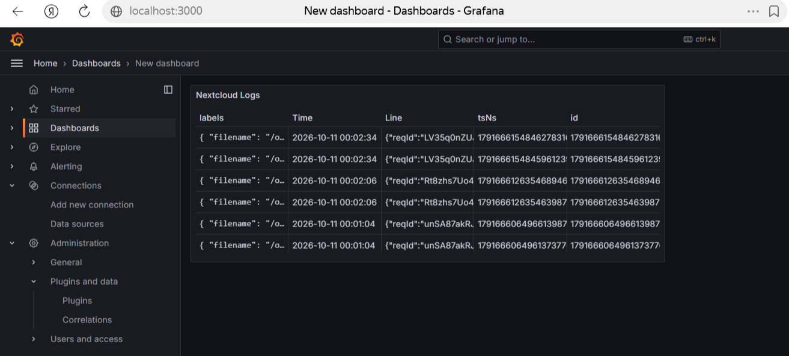

**Итоговый дашборд:**

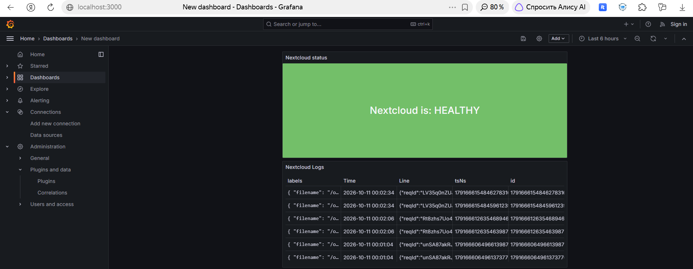

Экспорт дашборда сохранён в файле `dashboard-nextcloud.json`.


## Ответы на вопросы

### 1. Чем SLO отличается от SLA?

**SLA (Service Level Agreement)** - это соглашение об уровне обслуживания между поставщиком услуги и заказчиком. Это формальный договорный документ: в нём указаны гарантии (например, доступность сервиса 99,9 % в месяц) и последствия их нарушения (штрафы, компенсации, возврат части оплаты).

**SLO (Service Level Objective)** - это целевое значение показателя качества, к которому стремится команда. Обычно это внутренняя цель, которую ставят строже, чем в SLA, чтобы был запас на случай сбоев. У SLO нет юридических последствий, но по нему команда принимает решения (например, остановить релизы, если лимит ошибок исчерпан).

Связывает их **SLI (Service Level Indicator)** - измеряемый показатель (доля успешных запросов, время ответа, доступность), по которому проверяют выполнение SLO и SLA.

Пример: SLI - доля успешных запросов; SLO - не менее 99,95 % успешных запросов за месяц; SLA - обязательство перед клиентом на уровне 99,9 % с возвратом денег, если оно нарушено.

### 2. Чем отличается инкрементальный бэкап от дифференциального?

Оба вида опираются на полный бэкап и сохраняют только изменения после него.

**Инкрементальный бэкап** копирует только то, что изменилось с момента последнего бэкапа любого типа (полного или инкрементального).
- Плюсы: самый быстрый и занимает меньше всего места.
- Минусы: для восстановления нужен последний полный бэкап и *все* инкрементальные копии по порядку. Если одна из них потеряна или повреждена, цепочка ломается. Восстановление дольше.

**Дифференциальный бэкап** копирует всё, что изменилось с момента последнего полного бэкапа, и с каждым днём становится больше.
- Плюсы: для восстановления нужны только последний полный бэкап и последний дифференциальный, поэтому восстановление быстрее и надёжнее.
- Минусы: занимает больше места и создаётся дольше, чем инкрементальный.

### 3. В чём разница между мониторингом и observability?

**Мониторинг** — это сбор заранее выбранных метрик и проверок (загрузка процессора, доступность сервиса, ответ на запрос) и оповещения при выходе значений за пороги. Он отвечает на вопрос «что сломалось?» и хорошо работает для проблем, которые мы предвидели заранее.

**Observability (наблюдаемость)** — это свойство системы, при котором по её внешним данным (метрикам, логам, трассировкам) можно понять, что происходит внутри, и найти причину проблемы, в том числе непредвиденной. Она отвечает на вопрос «почему это произошло?» и позволяет задавать новые вопросы, не добавляя новых проверок.

Мониторинг - часть observability, в этой работе Zabbix с триггером `healthy` / `unhealthy` - это мониторинг: он сообщает, что с Nextcloud что-то не так. А сочетание метрик Zabbix и логов Loki в одной Grafana говорим об observability: по логам можно увидеть, что именно происходило в момент сбоя.

---

## Вывод

В ходе работы развёрнут стек из Nextcloud, Promtail, Loki, Zabbix и Grafana в Docker. Настроены сбор и хранение логов Nextcloud, мониторинг его состояния с триггером на режим обслуживания и визуализация обоих источников данных в Grafana на одном дашборде. Проверена работа всей цепочки: изменение состояния Nextcloud отражается и в Zabbix, и в данных Grafana.

