# ЛР 2. Ansible + Caddy

## Для удобства!

- [Окружение](#-окружение)
- [Структура репозитория](#-структура-репозитория)
- [Подготовка](#-подготовка)
- [Часть 1. Установка и настройка Ansible](#часть-1-установка-и-настройка-ansible)
- [Часть 2. Установка Caddy](#часть-2-установка-caddy)
- [Часть 3. Настройка Caddyfile](#часть-3-настройка-caddyfile)
- [Задание 1. Плейбук для работы с файлом](#задание-1-плейбук-для-работы-с-файлом)
- [Задание 2a. Своя страница и заголовки](#задание-2a-своя-страница-и-заголовки)
- [Быстрый запуск](#-быстрый-запуск)
- [Выводы](#-выводы)


## Окружение

| Компонент | Значение |
|---|---|
| Хост | MacBook Pro (Apple M3) |
| Виртуализация | Multipass |
| Гостевая ОС | Ubuntu 22.04.5 LTS (aarch64) |
| Ansible | core 2.17.14 |
| Веб-сервер | Caddy |
| IP виртуальной машины | 192.168.252.2 |

> **Работа выполнялась локально**, поэтому Ubuntu поднята на маке через Multipass. Вместо домена Caddy слушает порт `:80` по HTTP 


## Структура 

```
.
├── ansible.cfg                  # базовый конфиг Ansible
├── inventory/
│   └── hosts                    # список хостов
├── caddy_deploy.yml             # плейбук установки Caddy
├── file_playbook.yml            # плейбук задания 1
├── roles/
│   └── caddy_deploy/
│       ├── tasks/main.yml       # шаги роли
│       ├── templates/Caddyfile.j2   # шаблон конфига Caddy
│       ├── vars/main.yml        # переменные
│       └── files/index.html     # своя страница
└── screenshots/                 # скриншоты хода работы
```

---

## Подготовка

Создаём виртуальную машину с Ubuntu 22.04 и заходим в неё под root:

```bash
multipass launch 22.04 --name lab --cpus 2 --memory 2G --disk 10G
multipass shell lab
sudo -i
```

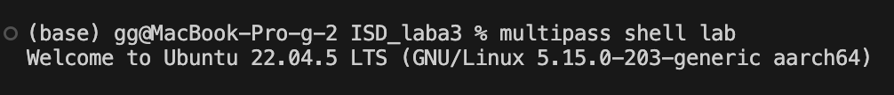

---

## Часть 1. Установка и настройка Ansible

### 1.1. Установка pip

```bash
apt update && apt install -y curl python3-distutils
curl https://bootstrap.pypa.io/get-pip.py -o get-pip.py && python3 get-pip.py
```

### 1.2. Установка Ansible

```bash
python3 -m pip install ansible
ansible --version
```

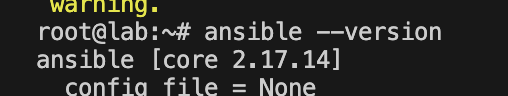

### 1.3. Рабочая директория и конфиги

```bash
mkdir -p ~/ansible/inventory && cd ~/ansible
```

**`ansible.cfg`**
```ini
[defaults]
host_key_checking = false
inventory = inventory/hosts
```

**`inventory/hosts`**
```ini
[my_servers]
local_server ansible_host=localhost
```

### 1.4. Проверка подключения к клиенту

```bash
ansible my_servers -m ping -c local
ansible my_servers -m setup -c local
```

Ansible успешно подключается к хосту: `SUCCESS`, `"ping": "pong"`, `setup` собирает факты о системе

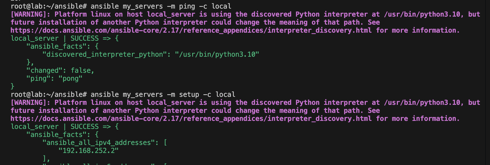

> Ключ `-c local` нужен для локального подключения. Без него Ansible пытался бы подключиться по SSH

### 1.5. Ad-hoc команды: создание и удаление файла

```bash
ansible my_servers -c local -m shell -a 'echo test_file_content > $HOME/test.txt'
cat ~/test.txt
ansible my_servers -c local -m file -a 'path=$HOME/test.txt state=absent'
cat ~/test.txt
```

Файл создан `shell`, а потом удалён `file`

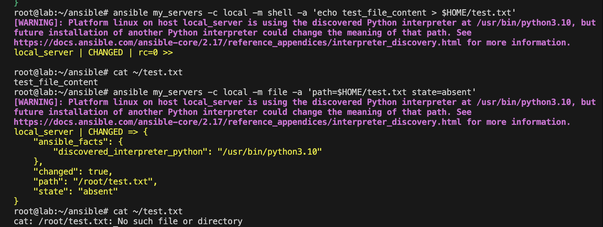

---

## Часть 2. Установка Caddy

### 2.1. Создание роли

```bash
mkdir roles && cd roles
ansible-galaxy init caddy_deploy
cd ..
```

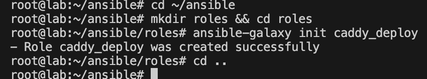

### 2.2. Задачи роли

В `roles/caddy_deploy/tasks/main.yml` описаны шаги:

1. установка зависимостей (`debian-keyring`, `apt-transport-https`, `curl`…);
2. добавление GPG-ключа репозитория Caddy;
3. подключение репозиториев `deb` и `deb-src`;
4. установка пакета `caddy`.

Полный файл: [`roles/caddy_deploy/tasks/main.yml`](roles/caddy_deploy/tasks/main.yml)

### 2.3. Плейбук

**`caddy_deploy.yml`**
```yaml
---
- name: Install and configure Caddy webserver
  hosts: my_servers
  connection: local
  roles:
    - caddy_deploy
```

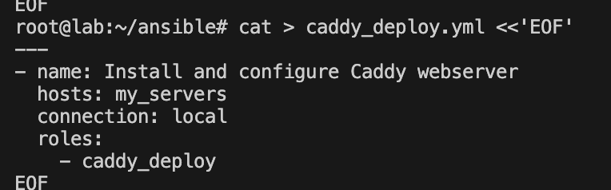

### 2.4. Запуск

```bash
ansible-playbook caddy_deploy.yml
systemctl status caddy
```

Все задачи выполнены (`failed=0`), сервис Caddy в состоянии `active (running)`.

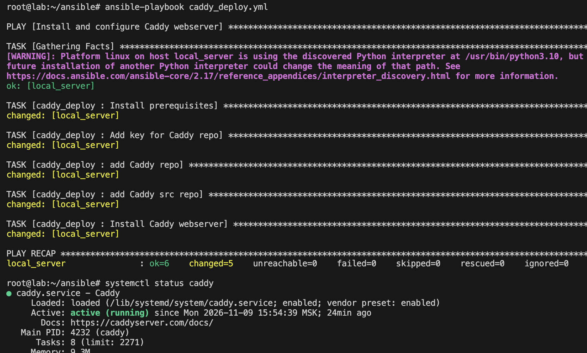

---

## Часть 3. Настройка Caddyfile

### 3.1. Домен

Локальная ВМ недосьупна из интернета. Вместо домена используется `:80`, sorryyyyyy

### 3.2. Шаблон и переменные

**`roles/caddy_deploy/templates/Caddyfile.j2`** 
```
{{ domain_name }} {
    root * /usr/share/caddy
    file_server

    log {
        output file {{ log.file }}
        format json
        level {{ log.level }}
    }
}
```

**`roles/caddy_deploy/vars/main.yml`**
```yaml
domain_name: ":80"

log:
  file: /var/log/caddy/access.log
  level: "INFO"
```

> Лог пишется в `/var/log/caddy/`, а не прямо в `/var/log/` тк Caddy работает от пользователя `caddy`, и у него есть права только на свою папку

### 3.3. Новые задачи

```yaml
- name: Create config file
  template:
    src: templates/Caddyfile.j2
    dest: /etc/caddy/Caddyfile

- name: Reload with new config
  service:
    name: caddy
    state: reloaded
```

### 3.4. Результат

Шаблон отрендерился в `/etc/caddy/Caddyfile` с подставленными переменными, Caddy перезагрузил конфиг

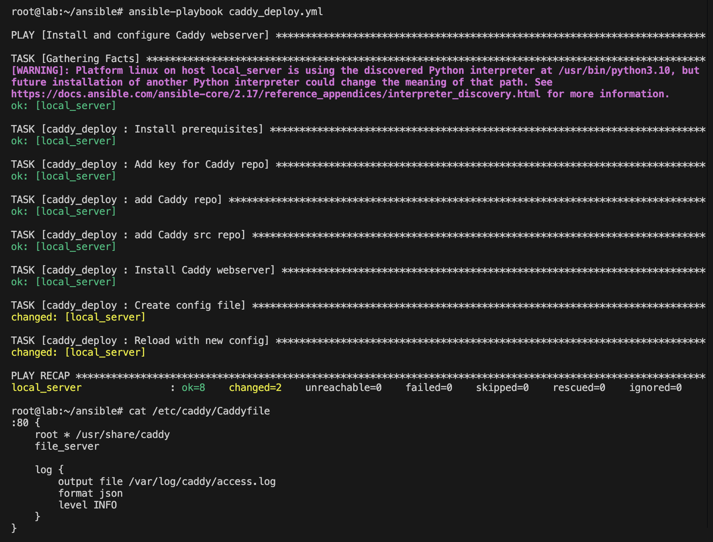

Страница Caddy по адресу `http://192.168.252.2`:

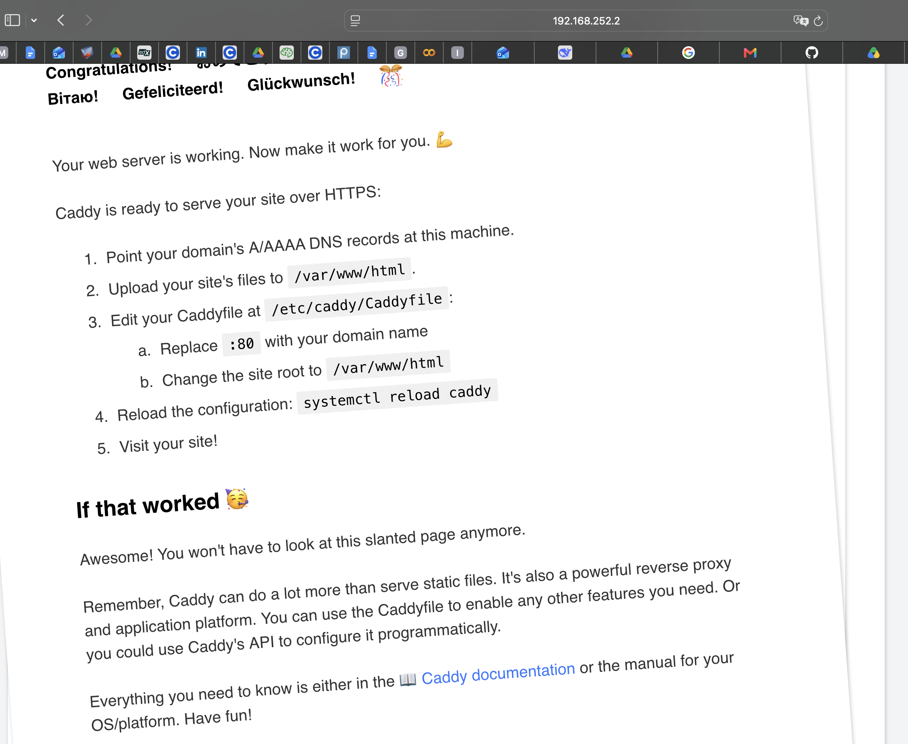

---

## Задание 1. Плейбук для работы с файлом

**Шаги:**
1. создание файла с содержимым `test_file_content`
2. чтение файла и вывод содержимого
3. изменение содержимого на `new_changed_content`
4. удаление файла

Полный файл: [`file_playbook.yml`](file_playbook.yml)

```bash
ansible-playbook file_playbook.yml
ls ~/test.txt
```

В выводе видно содержимое до изменения (`test_file_content`) и после (`new_changed_content`). В конце файла не существует.

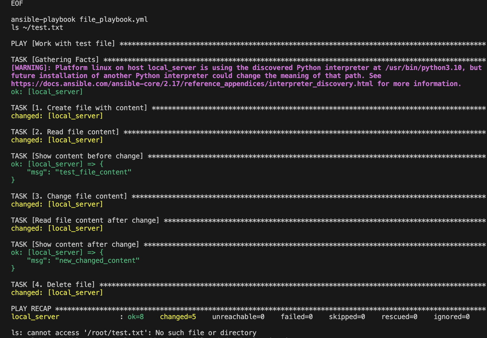

---

## Задание 2a. Своя страница и заголовки

### Умные мысли нас преследовали, а мы не убегали, поэтому:

- **Своя страница** `index.html` с Hello world вместо стандартной страницы Caddy
- **Новый путь** к сайту `/var/www/html`, вынесен в переменную `site_root`
- **HTTP-заголовки** через директиву `header`:

| Заголовок | Действие |
|---|---|
| `X-Lab-Work: Ansible + Caddy` | свой заголовок |
| `X-Frame-Options: DENY` | запрет встраивания сайта во `<iframe>` (защита от clickjacking) |
| `-Server` | удаление заголовка `Server`, чтобы не раскрывать ПО сервера |

### Итоговый шаблон

**`roles/caddy_deploy/templates/Caddyfile.j2`**
```
{{ domain_name }} {
    root * {{ site_root }}
    file_server

    header {
        X-Lab-Work "Ansible + Caddy"
        X-Frame-Options "DENY"
        -Server
    }

    log {
        output file {{ log.file }}
        format json
        level {{ log.level }}
    }
}
```

### Новые задачи (перед созданием конфига)

```yaml
- name: Create site directory
  file:
    path: "{{ site_root }}"
    state: directory
    mode: "0755"

- name: Copy custom index.html
  copy:
    src: index.html
    dest: "{{ site_root }}/index.html"
    mode: "0644"
```

### Проверка

```bash
ansible-playbook caddy_deploy.yml
curl -I http://localhost
curl http://localhost
```

Заголовки `X-Lab-Work` и `X-Frame-Options` присутствуют, заголовка `Server` нет, отдаётся своя страница:

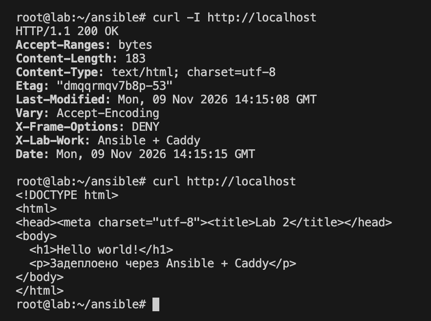

В браузере по адресу `http://192.168.252.2`:

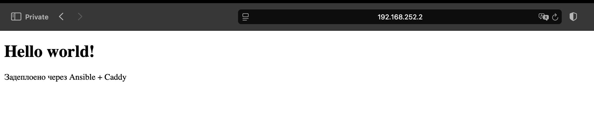

---

## ✅ Выводы

В ходе лабораторной работы разобрались, как работает Ansible и с его помощью автоматически установили и настроили веб-сервер Caddy на локальной виртуальной машине с Ubuntu. Попробовали ad-hoc команды, роли, плейбуки и шаблоны Jinja2, а ещё заменили стандартную страницу Caddy на свою и добавили к ней HTTP-заголовки!
